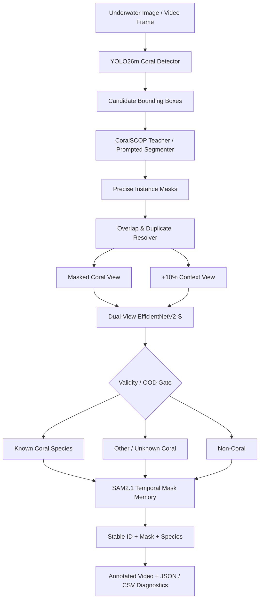
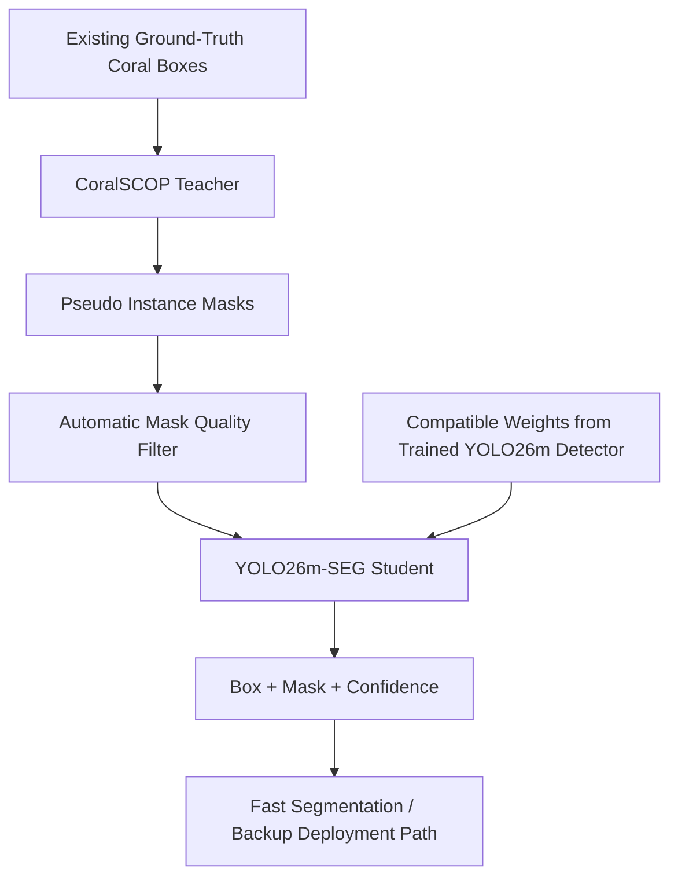
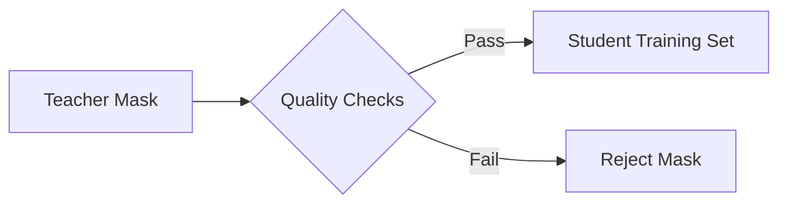
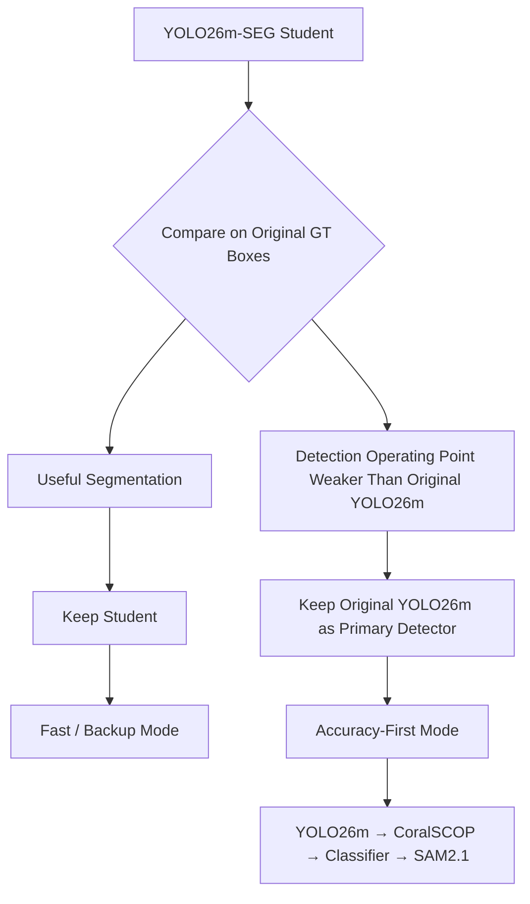
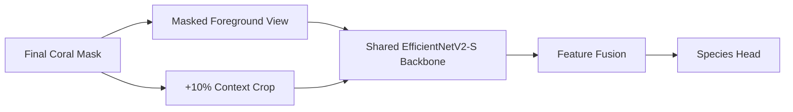
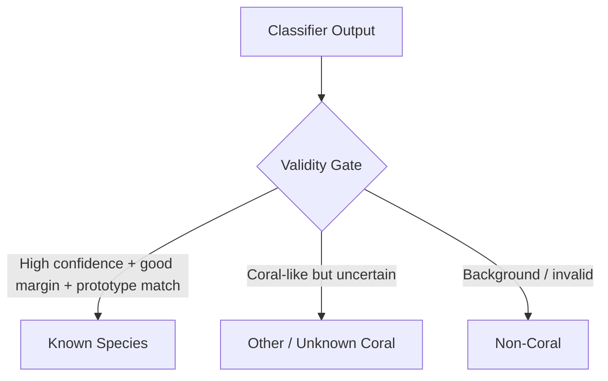
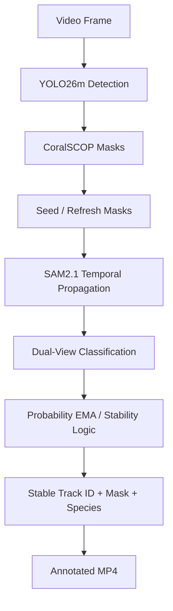
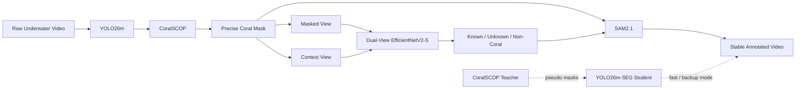

# 🪸 CoralGuard-X

### Accuracy-First Coral Reef Detection, Instance Segmentation, Species Classification & Stable Video Analysis

CoralGuard-X is an end-to-end **Computer Vision** project for analyzing coral reefs in underwater images and videos.

The project started as a classical **Detection → Crop → Classification** pipeline and evolved into a multi-stage system that combines:

- **YOLO26m** for coral detection,
- **CoralSCOP** for precise box-prompted instance segmentation,
- **Dual-View EfficientNetV2-S** for coral species classification,
- a pragmatic **Unknown / Non-Coral rejection layer**,
- and **SAM2.1** for temporal mask propagation and video stability.

A major part of the project is a **Teacher–Student segmentation experiment** that uses CoralSCOP-generated pseudo masks to train a faster YOLO26m-SEG student without manually annotating thousands of pixel-level masks.

> **Current design philosophy:** use the strongest component for each sub-task instead of forcing one model to solve detection, segmentation, classification, and temporal tracking alone.

---

## 🎯 Project Goal

Given an underwater image or video, CoralGuard-X aims to:

1. detect visible coral instances,
2. isolate each instance from background and neighboring corals,
3. classify the coral into one of the known operational labels when confidence is adequate,
4. reject uncertain or non-coral regions instead of forcing a species prediction,
5. maintain stable object identity, mask, and species information across video frames,
6. export annotated video plus machine-readable diagnostics.

The original system separated two questions:

- **Detection:** *Where is the coral?*
- **Classification:** *What coral type is it?*

The project later added a third spatial question:

- **Segmentation:** *Which pixels actually belong to this coral instance?*

and a temporal question:

- **Tracking / temporal memory:** *Is this still the same coral across consecutive frames?*

---

# 🧠 Final Accuracy-First Architecture



### Why this architecture?

The final architecture is the result of multiple experiments rather than a preselected model stack.

- **YOLO26m** remained the stronger primary detector when evaluated against the original detection ground truth.
- **CoralSCOP** directly generates precise coral masks from detector boxes, reducing background contamination inside the crop.
- **Dual-View EfficientNetV2-S** receives both the masked coral foreground and a small local context crop.
- **OOD / validity logic** prevents the classifier from always forcing one of the known labels.
- **SAM2.1** provides temporal mask memory for more stable video output.
- **YOLO26m-SEG Student** is retained as a fast / backup segmentation path.

---

# 🧬 Architecture Evolution

CoralGuard-X evolved through several design generations.

```mermaid
flowchart LR
    A[V1: YOLO11n + MobileNetV4] --> B[Improved YOLO11 Stage 3]
    B --> C[YOLO26m + EfficientNetV2-S]
    C --> D[Need Better Spatial Isolation]
    D --> E[CoralSCOP Prompted Segmentation]
    E --> F[Teacher → Student Segmentation]
    F --> G[YOLO26m-SEG Student]
    G --> H[Original-GT Comparison]
    H --> I[Accuracy-First Hybrid Decision]
    I --> J[YOLO26m + CoralSCOP + Dual-View EfficientNetV2-S + SAM2.1]
```



### Evolution in plain language

**V1 — Detection + Classification**  
A detector localized coral using bounding boxes, then a classifier predicted the species from the crop.

**V2 — Better detector and classifier**  
The project moved to stronger models and higher-resolution inference to improve small/crowded coral performance.

**V3 — Segmentation becomes necessary**  
Bounding boxes were sometimes too loose, contained neighboring corals, or included substantial rock/background. This directly degraded classification quality.

**V4 — Teacher–Student segmentation**  
CoralSCOP was introduced as a segmentation teacher to generate pseudo masks from the existing bounding boxes. Those masks were then used to train a YOLO26m-SEG student.

**Current — Accuracy-first hybrid**  
Evaluation showed that the original YOLO26m detector should remain the primary detector, while CoralSCOP is used for high-quality masks. The student is preserved as a faster alternative rather than discarded.

---

# 🎓 Teacher–Student Segmentation Experiment

This is one of the central engineering experiments in CoralGuard-X.

## The problem

The original audited dataset contained **bounding-box annotations**, but did **not** contain human-annotated pixel-level instance masks.

Bounding boxes alone caused several practical issues:

- excessive background inside the crop,
- neighboring coral inside the same rectangular region,
- overlapping colonies,
- irregular coral geometry that cannot be represented well by a rectangle,
- reduced classification quality because the classifier receives irrelevant pixels.

Manually segmenting every coral instance would require substantial annotation effort.

## The solution

Use an existing coral-specific segmentation model as a **Teacher** to create pseudo masks, then train a faster **Student** model on those masks.



## Teacher — CoralSCOP

CoralSCOP receives a coral bounding box as a prompt and predicts a pixel-level mask for the object inside that box.

The existing annotation therefore becomes:

```text
Ground-Truth Bounding Box
          ↓
     CoralSCOP Teacher
          ↓
   Pseudo Instance Mask
```

The masks are called **pseudo masks** because they were generated by a model rather than manually drawn by a human annotator.

They are therefore useful training supervision, but they are **not independent segmentation ground truth**.

## Automatic pseudo-mask quality filtering

Not every automatically generated mask should be trusted.

Before student training, generated masks are checked using multiple criteria such as:

- CoralSCOP mask confidence,
- minimum foreground pixels,
- mask area,
- mask-to-box area ratio,
- mask bounding-box alignment with the original GT box,
- mask file validity,
- contour / polygon extraction validity.

Conceptually:



This prevents obvious pseudo-label failures from being treated as reliable supervision.

## Student — YOLO26m-SEG

The student is a segmentation-capable YOLO26m model.

It is initialized from:

1. the segmentation-capable YOLO26m-SEG architecture, and
2. compatible weights from the already-trained coral detector.

The goal is to transfer two useful priors:

- **coral localization knowledge** from the trained detector,
- **pixel-level coral shape supervision** from CoralSCOP pseudo masks.

The student learns to produce in one forward pass:

```text
Bounding Box + Instance Mask + Confidence
```

## Important terminology

> This project uses a **Pseudo-Label Teacher–Student learning strategy**.
>
> It is **not direct logit distillation** between Teacher and Student networks.
>
> CoralSCOP provides pseudo-mask supervision; the student learns from those generated targets.

---

# 📊 Teacher–Student Evaluation

The YOLO26m-SEG student successfully learned meaningful coral masks from CoralSCOP pseudo labels.

### Pseudo-mask validation

| Metric | YOLO26m-SEG Student |
|---|---:|
| Box mAP@50 | **0.8110** |
| Box mAP@50:95 | **0.6411** |
| Mask mAP@50 | **0.7875** |
| Mask mAP@50:95 | **0.5905** |
| Mask mAP@75 | **0.6308** |

> **Scientific note:** the mask metrics above measure agreement with CoralSCOP-generated pseudo masks. They should not be interpreted as independent performance against human-annotated segmentation ground truth.

### Evaluation against the original detection ground truth

The student was also evaluated against the original validation bounding boxes instead of only against pseudo-mask-derived labels.

| Metric | YOLO26m-SEG Student |
|---|---:|
| Best confidence | **0.40** |
| Precision | **0.7857** |
| Recall | **0.6836** |
| F1 | **0.7311** |

This comparison was important because it exposed a system-level trade-off: the student learned useful segmentation, but the original YOLO26m detector remained the stronger primary detector for the final accuracy-first system.

---

# ⚖️ Why the Student Did Not Replace the Teacher

A successful experiment is not always the final production path.

The student produced useful masks, but system evaluation showed that forcing it to replace the original detector would reduce the quality of the detection operating point.



### Final engineering decision

**Accuracy-First Mode**

```text
YOLO26m Detector
      ↓
CoralSCOP Precise Masks
      ↓
Dual-View EfficientNetV2-S
      ↓
OOD / Validity Logic
      ↓
SAM2.1
```

**Fast / Backup Mode**

```text
YOLO26m-SEG Student
      ↓
Direct Box + Mask
      ↓
Classifier
      ↓
SAM2.1
```

This is intentional. The student experiment is retained because it provides a faster deployment option and proves that pseudo-mask supervision can transfer coral segmentation knowledge into a single-stage student model.

---

# 🧭 Final Module Responsibilities

| Module | Responsibility | Input | Output |
|---|---|---|---|
| YOLO26m | Coral candidate detection | Underwater frame | Coral boxes + confidence |
| CoralSCOP | Precise coral segmentation | Frame + box prompt | Instance mask |
| Duplicate / overlap resolver | Remove duplicate spatial hypotheses | Boxes + masks | Clean instances |
| Dual-View EfficientNetV2-S | Species classification | Masked coral + local context | Class probabilities |
| OOD / validity gate | Reject uncertain predictions | Class confidence + margin + embedding similarity | Known / Unknown / Non-Coral |
| SAM2.1 | Temporal mask memory | Seed masks + video frames | Propagated instance masks |
| Video renderer | Human-readable output | Tracks + labels + masks | Annotated MP4 |

---

# 👁️ Dual-View Classification

A normal classifier sees a rectangular crop. In underwater scenes, this may include rock, sand, algae-like textures, neighboring coral, or empty water.

CoralGuard-X therefore uses two synchronized views of the same coral:



### Why two views?

- **Masked view** emphasizes coral morphology and texture.
- **Context view** preserves useful local environmental and boundary information.
- Shared feature extraction keeps the two views aligned in the same representation space.

The current operational label set is:

- `Euphflfiaancora`
- `Favosites`
- `Platygyra`
- `Sarcophyton`
- `Sinularia`
- `WavingHand`
- plus a training-time / rejection-oriented `NON_CORAL` concept in the dual-view pipeline.

> Some source labels require taxonomy verification. The project intentionally preserves the audited operational labels rather than silently renaming them.

---

# 🚫 Unknown / OOD Rejection

A closed-set classifier will normally force every input into one of its known classes.

That is dangerous for real underwater deployment because the system may encounter:

- unseen coral species,
- damaged / ambiguous coral structures,
- non-coral background,
- heavily occluded objects,
- low-quality or out-of-domain imagery.

CoralGuard-X therefore adds a pragmatic validity gate based on:

- top-1 class confidence,
- top-1 vs top-2 margin,
- embedding similarity to known-class prototypes,
- explicit `NON_CORAL` probability.



> `Other / Unknown Coral` is a pragmatic rejection mechanism, not a fully validated open-set recognition benchmark. A dedicated unseen-species evaluation set is still required for scientific open-set claims.

---

# 🎥 Video Pipeline

The video stage extends image inference into a temporal system.



### Video objectives

- reduce mask flicker,
- reduce species-label flicker,
- preserve the same object identity over time,
- avoid re-solving segmentation from scratch on every frame when temporal memory can propagate a mask,
- export stable visual results and diagnostics.

### Current runtime optimization work

Video inference is one of the active optimization areas.

The project has tested:

- CoralSCOP refresh intervals,
- SAM2 propagation between refresh frames,
- classification stride,
- track pruning,
- reduced repeated disk I/O,
- high-quality FFmpeg H.264 output,
- fast demo mode for rapid presentation output.

Known runtime challenges include track fragmentation and the cost of running CoralSCOP on many candidates repeatedly.

---

# 🗂️ Dataset

Audited detection dataset:

| Split | Images | Coral Instances |
|---|---:|---:|
| Train | 452 | 1,540 |
| Validation | 100 | 354 |
| Test | 94 | 304 |
| **Total** | **646** | **2,198** |

The project uses a single coral detection category for localization, while species labels are preserved for classification and analysis.

### Classification ROI counts

| Label | Train | Validation | Test |
|---|---:|---:|---:|
| Euphflfiaancora | 298 | 62 | 48 |
| Favosites | 165 | 24 | 32 |
| Platygyra | 130 | 30 | 25 |
| Sarcophyton | 232 | 64 | 43 |
| Sinularia | 510 | 136 | 114 |
| WavingHand | 205 | 38 | 42 |
| **Total** | **1,540** | **354** | **304** |

### Data quality principles

The project emphasizes:

- annotation consistency,
- source-aware train/validation/test splitting,
- duplicate / near-duplicate awareness,
- small / medium / large coral analysis,
- crowded-scene analysis,
- realistic underwater augmentation,
- preserving a held-out detector test split for final evaluation.

---

# 📈 Verified Model Results

The following metrics are historical verified checkpoints from the project development process. They are not all directly comparable because some experiments use different architectures or evaluation purposes.

## YOLO11n Stage 3 detector

| Metric | Value |
|---|---:|
| mAP@50:95 | 0.473 |
| mAP@50 | 0.793 |
| Precision | 0.7937 |
| Recall | 0.7175 |
| F1 | 0.7537 |

## MobileNetV4 V3 classifier

| Metric | Value |
|---|---:|
| Validation Accuracy | 0.9011 |
| Validation Macro-F1 | 0.9170 |
| Test Accuracy | 0.8980 |
| Test Macro-F1 | 0.8961 |

## Historical integrated YOLO11 Stage 3 + MobileNetV4 V3 baseline

| Metric | Value |
|---|---:|
| Validation images | 100 |
| GT coral instances | 354 |
| Matched detections | 254 |
| Correct detection + species | 239 |
| End-to-End Species F1 | 0.7092 |

## YOLO26m detector before segmentation

| Metric | Value |
|---|---:|
| mAP@50:95 | 0.5071 |
| mAP@50 | 0.8069 |
| Precision | 0.8363 |
| Recall | 0.7147 |

## EfficientNetV2-S before dual-view retraining

| Metric | Value |
|---|---:|
| Validation Accuracy | 0.8898 |
| Validation Macro-F1 | 0.8838 |

For a consolidated metric history, see `MODEL_METRICS.md`.

---

# 🔬 Failure Analysis Drove the Architecture

The project deliberately avoids treating model replacement as the first response to every error.

The engineering workflow is:

```text
Data
  ↓
Annotation
  ↓
Detection
  ↓
Localization
  ↓
Segmentation
  ↓
Crop Quality
  ↓
Classification
  ↓
Tracking
  ↓
Deployment
```

Examples of findings that changed the system design:

- small and crowded coral were harder for the detector,
- bounding boxes could include too much background,
- neighboring coral could contaminate classification crops,
- classification errors were not the only source of end-to-end failure,
- video label flicker required temporal smoothing / memory,
- a segmentation student can be successful without necessarily being the best primary detector,
- pseudo-mask validation must not be reported as independent human-GT segmentation performance.

---

# 🧪 Experimental History

The project explored multiple model families and strategies, including:

- RF-DETR Medium,
- YOLO11n baseline,
- higher-resolution YOLO11 improvement stages,
- targeted small/crowded-object training,
- YOLO P2 experiments,
- MobileNetV4 classification,
- YOLO26m detection,
- EfficientNetV2-S classification,
- CoralSCOP prompted segmentation,
- YOLO26m-SEG Teacher–Student training,
- dual-view classification,
- OOD rejection,
- SAM2.1 temporal propagation.

Not every experiment became part of the final architecture. Failed or weaker approaches were retained as evidence for later decisions rather than hidden from the project history.

---

# 🖥️ Development Environment

The current local development environment was verified on:

```text
OS           : Windows
Python       : 3.12
GPU          : NVIDIA RTX A6000
VRAM         : ~48 GB
PyTorch      : 2.11.0 + CUDA 12.8
Ultralytics  : 8.4.117
Timm         : 1.0.22
OpenCV       : 5.0.0
FFmpeg       : Installed locally
```

The final local workflow is designed for high-memory NVIDIA GPU execution.

---

# 🚀 Quick Start

## 1. Clone the repository

```bash
git clone https://github.com/abobakerkamel/CoralGuard.git
cd CoralGuard
```

## 2. Create a Python environment

On Windows PowerShell:

```powershell
python -m venv .venv
.\.venv\Scripts\Activate.ps1
pip install -r requirements.txt
```

## 3. Add local-only assets

The repository intentionally excludes large datasets, model checkpoints, generated outputs, and third-party cloned repositories.

Prepare local folders for:

```text
data/
models/
outputs/
cache/
third_party/
```

## 4. Run the current accuracy-first notebook

```text
notebooks/06_final_accuracy_first/
CoralGuard_X_ACCURACY_FIRST_YOLO_CoralSCOP_DualView_SAM2_LOCAL.ipynb
```

For detailed setup and execution order, see:

- `SETUP_WINDOWS.md`
- `RUN_ORDER.md`
- `PROJECT_STATUS.md`
- `TROUBLESHOOTING.md`

---

# 📁 Repository Structure

```text
CoralGuard/
├── README.md
├── ARCHITECTURE.md
├── MODEL_METRICS.md
├── PROJECT_STATUS.md
├── RUN_ORDER.md
├── SETUP_WINDOWS.md
├── THIRD_PARTY_AND_LICENSES.md
├── TROUBLESHOOTING.md
├── requirements.txt
│
├── notebooks/
│   ├── 01_baselines/
│   ├── 02_yolo11_improvements/
│   ├── 03_integrated_v1/
│   ├── 04_yolo26_effnetv2/
│   ├── 05_segmentation_teacher_student/
│   └── 06_final_accuracy_first/
│
├── docs/
│   ├── MASTER_PROJECT_KNOWLEDGE_BASE.docx
│   ├── MASTER_PROJECT_KNOWLEDGE_BASE.pdf
│   ├── planning/
│   └── presentation/
│
├── data/
├── models/
├── outputs/
├── scripts/
└── third_party/
```

Some directories may contain only README placeholders in the public repository because large or licensed assets are intentionally kept local.

---

# 📦 Large Files Intentionally Excluded

The public repository should not contain:

- full raw datasets,
- large underwater video archives,
- `.pt` / `.pth` model checkpoints,
- training caches,
- generated video outputs,
- local virtual environments,
- cloned third-party repositories.

Reasons include:

- GitHub file-size limits,
- repository hygiene,
- reproducibility,
- external license requirements,
- avoiding accidental publication of large local artifacts.

---

# ⚠️ Scientific & Engineering Limitations

- CoralSCOP masks are **pseudo labels**, not independent human segmentation ground truth.
- Student mask mAP against CoralSCOP masks measures **teacher agreement**, not independent segmentation truth.
- `Other / Unknown Coral` is a pragmatic rejection rule, not a validated open-set recognition benchmark.
- The current dataset does not provide explicit supervised `Dead Coral` or `Algae` classes.
- Background negatives may contain unlabeled coral if the original annotations are not fully exhaustive.
- Historical classifier test data was exposed during earlier experimentation and should not be the sole basis for future model selection.
- Final video FPS, latency, and flicker should be reported only from measured runs.
- Taxonomic normalization of some operational source labels is still unresolved.

---

# 🛣️ Current Status & Roadmap

| Area | Status |
|---|---|
| Detection dataset audit | ✅ Completed |
| YOLO detector development | ✅ Completed / multiple versions tested |
| Classification baseline development | ✅ Completed |
| CoralSCOP pseudo-mask generation | ✅ Implemented |
| Teacher–Student YOLO26m-SEG training | ✅ Trained and validated |
| Dual-view classifier pipeline | 🟡 Implemented / active optimization |
| OOD / Unknown rejection logic | 🟡 Implemented, dedicated unseen-species validation pending |
| SAM2.1 temporal propagation | 🟡 Integrated / runtime tuning ongoing |
| Track-fragmentation reduction | 🟡 In progress |
| Final unseen detector test | ⏳ Pending final model freeze |
| Production real-time optimization | ⏳ Future work |

### Next technical priorities

- improve tracking association and reduce fragmented IDs,
- make CoralSCOP invocation more adaptive,
- finish final dual-view model selection,
- run final unseen evaluation after architecture freeze,
- measure end-to-end latency and video stability,
- investigate optimized deployment paths for near-real-time use.

---

# 📚 Project Documentation

For a complete reconstruction of the project history, troubleshooting, design decisions, architecture changes, and experimental context, see:

```text
docs/MASTER_PROJECT_KNOWLEDGE_BASE.pdf
```

Additional documents:

- `ARCHITECTURE.md` — architecture details,
- `MODEL_METRICS.md` — verified metric history,
- `PROJECT_STATUS.md` — current implementation state,
- `RUN_ORDER.md` — notebook execution order,
- `SETUP_WINDOWS.md` — local environment setup,
- `TROUBLESHOOTING.md` — known issues and fixes,
- `THIRD_PARTY_AND_LICENSES.md` — external components and licensing notes.

---

# 🔐 Third-Party Components & Licensing

CoralGuard-X integrates external open-source research components including CoralSCOP and SAM2.

Before commercial use, redistribution, or packaging of pretrained weights, review the exact license terms of every third-party dependency and checkpoint.

See:

```text
THIRD_PARTY_AND_LICENSES.md
```

for the repository-specific licensing notes.

---

# 💡 Key Engineering Lesson

The most important lesson from this project is that improving an AI system does not automatically mean changing the model.

Before changing architecture, identify the real failure source:

```text
Data?
Annotation?
Detection?
Localization?
Segmentation?
Crop Quality?
Classification?
Tracking?
Deployment?
```

That principle drove the evolution from a simple detector + classifier into the current accuracy-first hybrid system.

---

# 🪸 CoralGuard-X in One Diagram



---

## Author / Project

**CoralGuard-X**  
Computer Vision for underwater coral detection, segmentation, classification, and video analysis.

Developed as part of ongoing work during the project period at **NARSS**.

GitHub: `https://github.com/abobakerkamel/CoralGuard`

---

If you use or build on this repository, please review the third-party licenses and cite the original model authors where required.
