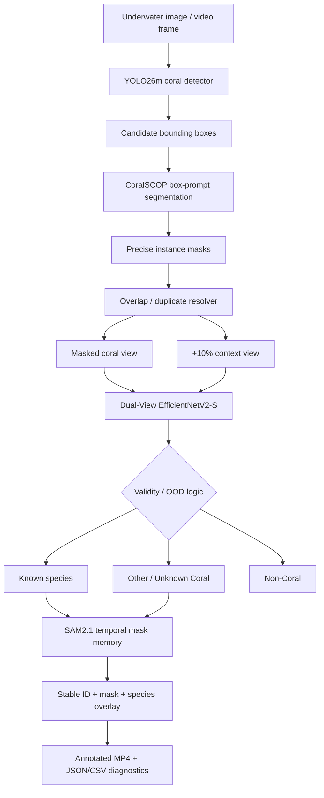

# CoralGuard-X — Coral Reef Detection, Segmentation & Species Classification

An end-to-end computer-vision pipeline for underwater coral analysis. The project evolved from a two-stage **detection → classification** system into an **accuracy-first video architecture** that combines a strong coral detector, prompt-based coral segmentation, a dual-view species classifier, pragmatic unknown rejection, and temporal mask propagation.

## Project goal

Given an underwater image or video, the system should:

1. locate visible coral instances,
2. isolate each coral from confusing background and overlapping colonies,
3. classify the coral into one of the operational known labels when confidence is adequate,
4. reject uncertain/non-coral cases instead of forcing a species label,
5. maintain stable object identity and masks through video,
6. export an annotated video plus machine-readable diagnostics.

The original project plan defined detection as **“where is the coral?”** and classification as **“what type is it?”**, then integrated both into recorded-video and real-time inference. See `docs/` for the complete planning and knowledge-base documents.

---

## Final accuracy-first architecture



### Why this architecture?

- The **old YOLO26m detector** remained stronger on the original ground-truth detection boxes than the segmentation student.
- **CoralSCOP** directly produces high-quality coral masks from YOLO box prompts, reducing background contamination and overlap problems.
- The classifier receives both a **masked coral foreground** and a **small context crop**, so it can use morphology/texture without losing all local context.
- **SAM2.1** is used for temporal continuity in video rather than re-solving every frame independently.
- The separately trained **YOLO26m-SEG student** is retained as a fast/backup segmentation route, not the primary accuracy-first path.

---

## Dataset snapshot

Audited detection data:

| Split | Images | Coral instances |
|---|---:|---:|
| Train | 452 | 1,540 |
| Validation | 100 | 354 |
| Test | 94 | 304 |
| **Total** | **646** | **2,198** |

Operational classifier labels observed in the audited annotations:

- `Euphflfiaancora`
- `Favosites`
- `Platygyra`
- `Sarcophyton`
- `Sinularia`
- `WavingHand`

> Taxonomy note: some source labels require scientific-name verification. The repository deliberately preserves the operational dataset labels instead of silently rewriting them.

The held-out detector test split is intended to remain untouched until final model selection.

---

## Key verified results

### YOLO11n Stage 3

- mAP@50:95: **0.473**
- mAP@50: **0.793**
- Precision: **0.7937**
- Recall: **0.7175**
- F1: **0.7537**

### MobileNetV4 V3 classifier

- Validation Accuracy: **0.9011**
- Validation Macro-F1: **0.9170**
- Test Accuracy: **0.8980**
- Test Macro-F1: **0.8961**

### Historical integrated Stage 3 + MobileNetV4 V3 baseline

- Detection/classification validation images: 100
- Ground-truth objects: 354
- Matched detections: 254
- Correct detection + species: 239
- End-to-End Species F1: **0.7092**

### YOLO26m detector before segmentation

- mAP@50:95: **0.5071**
- mAP@50: **0.8069**
- Precision: **0.8363**
- Recall: **0.7147**

### EfficientNetV2-S classifier before dual-view retraining

- Validation Accuracy: **0.8898**
- Validation Macro-F1: **0.8838**

### YOLO26m-SEG Teacher → Student experiment

Pseudo-mask validation:

- Box mAP@50:95: **0.6411**
- Box mAP@50: **0.8110**
- Mask mAP@50:95: **0.5905**
- Mask mAP@50: **0.7875**

Original-GT operating point:

- Confidence: **0.40**
- Precision: **0.7857**
- Recall: **0.6836**
- F1: **0.7311**

These mask metrics measure agreement against CoralSCOP-generated pseudo masks, not independent human mask ground truth.

---

## Repository map

```text
CoralGuard-X_GitHub_Ready/
├── README.md
├── ARCHITECTURE.md
├── PROJECT_STATUS.md
├── MODEL_METRICS.md
├── SETUP_WINDOWS.md
├── RUN_ORDER.md
├── TROUBLESHOOTING.md
├── UPLOAD_TO_GITHUB.md
├── THIRD_PARTY_AND_LICENSES.md
├── requirements.txt
├── notebooks/
│   ├── 01_baselines/
│   ├── 02_yolo11_improvements/
│   ├── 03_integrated_v1/
│   ├── 04_yolo26_effnetv2/
│   ├── 05_segmentation_teacher_student/
│   └── 06_final_accuracy_first/
├── docs/
│   ├── MASTER_PROJECT_KNOWLEDGE_BASE.docx
│   ├── MASTER_PROJECT_KNOWLEDGE_BASE.pdf
│   ├── planning/
│   └── presentation/
├── assets/
│   ├── results/
│   └── sample_detection/
├── data/README.md
├── models/README.md
├── outputs/README.md
├── third_party/README.md
└── scripts/
```

---

## Start here

For the current final path, use:

`notebooks/06_final_accuracy_first/CoralGuard_X_ACCURACY_FIRST_YOLO_CoralSCOP_DualView_SAM2_LOCAL.ipynb`

Then read:

1. `SETUP_WINDOWS.md`
2. `RUN_ORDER.md`
3. `PROJECT_STATUS.md`
4. `TROUBLESHOOTING.md`

For full historical reconstruction and design rationale, open:

`docs/MASTER_PROJECT_KNOWLEDGE_BASE.pdf`

---

## Important scientific limitations

- CoralSCOP-generated masks are **pseudo labels**, not independent manually annotated mask ground truth.
- `Other/Unknown Coral` is a **pragmatic rejection policy**, not a fully validated open-set recognition system.
- `Dead Coral` and `Algae` are **not explicit supervised classes** in the current audited dataset.
- Background negatives assume the available coral boxes are sufficiently exhaustive; missed annotations can contaminate `NON_CORAL` samples.
- The historical classifier test set was exposed during earlier experimentation and should not be used as the sole basis for future model selection.
- Video stability metrics should be reported from actual runs; do not infer final FPS or flicker rate before measuring them.

---

## Large files intentionally excluded

The repository package does **not** include:

- the full raw dataset,
- the 212 MB project video ZIP,
- trained `.pt` / `.pth` checkpoints,
- cache folders,
- generated outputs,
- cloned third-party repositories.

These are excluded because of GitHub file-size limits, licensing, reproducibility, and repository hygiene. See `data/README.md`, `models/README.md`, and `third_party/README.md`.
